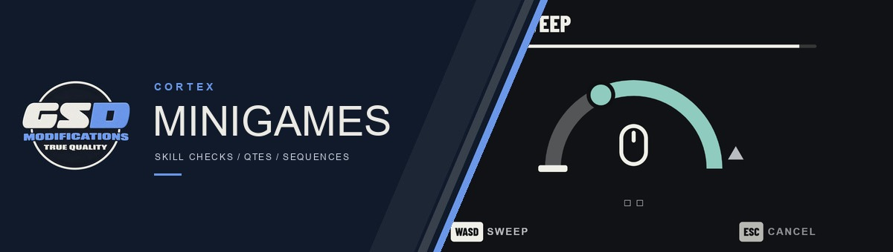
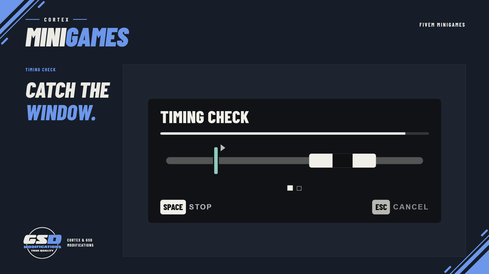
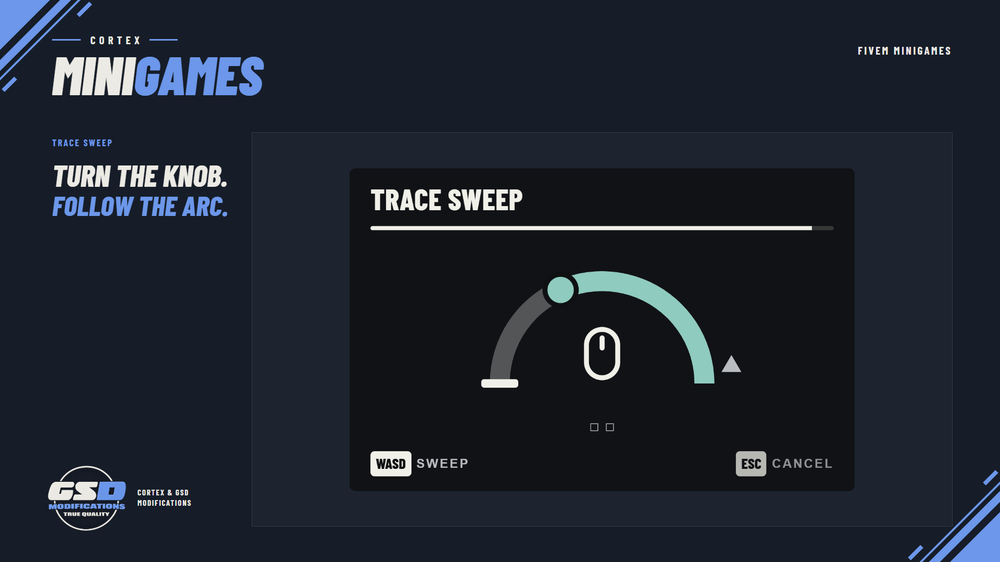
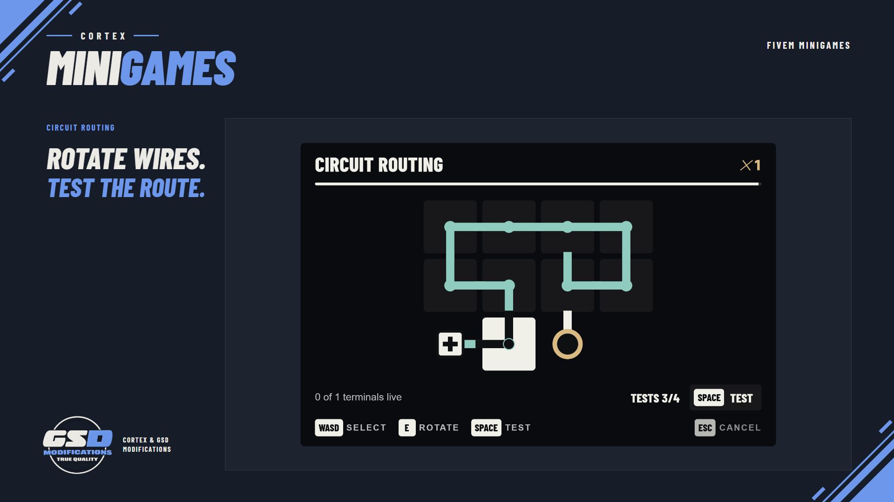
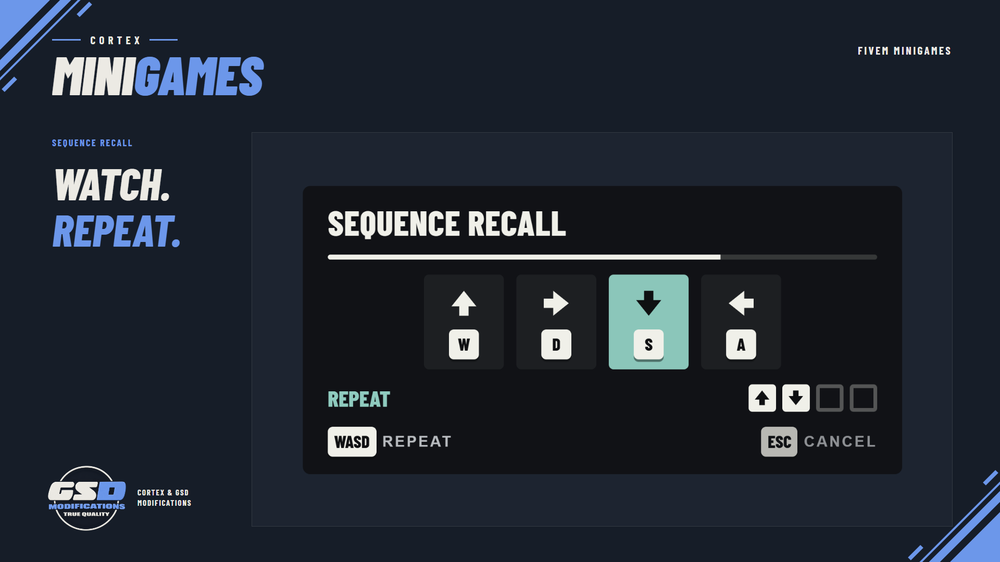
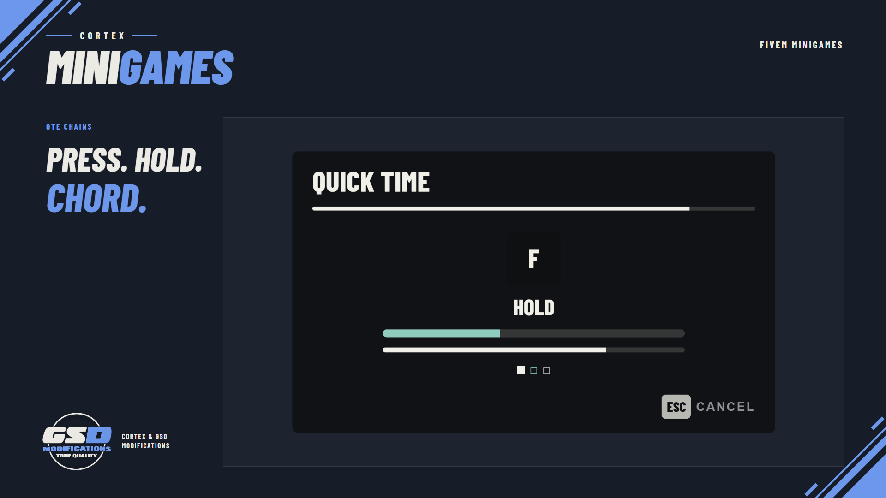
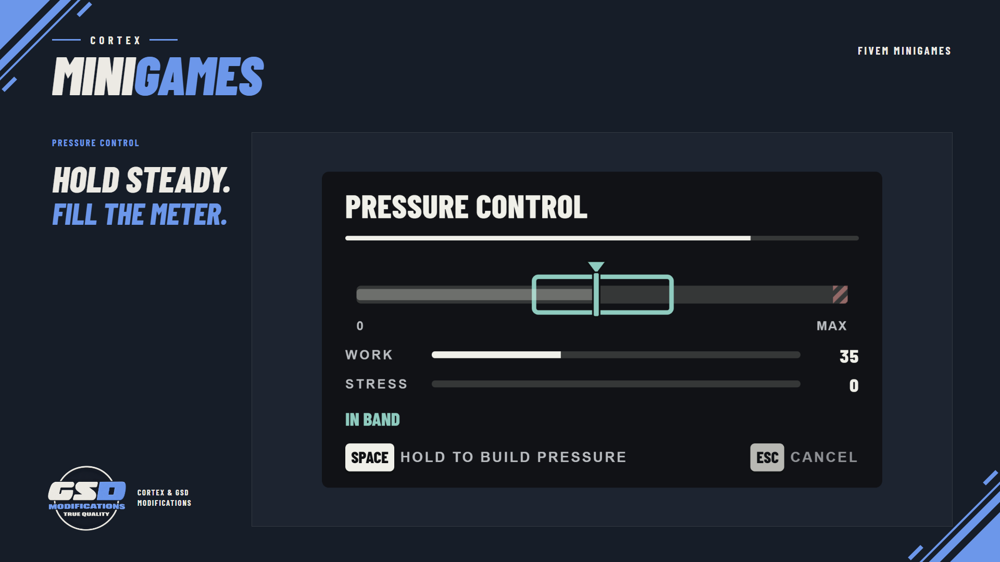

# Cortex Minigames



[](https://github.com/IEver3st/cortex-minigames/releases/latest)
[](LICENSE)
[](https://discord.gg/Atwt5nxaCV)
[](https://gsd-modifications.tebex.io/)

Free public release. Twelve minigames, composable QTEs and server-issued attempts for FiveM
resources. The package includes readable Lua, a compiled Svelte UI, configuration, locales and a
copyable integration demo. The resource folder must remain named `cortex-minigames`.

Results describe what happened. They never authorize a reward on their own.

- Games: Timing Check, Sequence Recall, Pressure Control, Signal Lock, Circuit Routing,
  Pin & Tension, Wave Match, Trace Path, Pattern Rebuild, Pulse Sync, Mash, Trace Sweep. Details
  and tuning:
  [docs/games.md](docs/games.md).
- QTE primitives: press, hold, release, alternate, chord, react, plus a rate-capped tap.
- Sequences: bounded, linear compositions with stop, continue or retry policies and one deadline.
- Server-issued attempts: server-created, player-bound, expiring, replay-safe results delivered only
  to the owning server resource. Security model: [docs/security.md](docs/security.md).
- Keyboard, mouse and controller. Presets `easy`, `normal`, `hard`, `expert`. Seeded generation.

## Screenshots

| | |
| --- | --- |
|  |  |
|  |  |
|  |  |

Captured from the real UI. Download the latest build from
[Releases](https://github.com/IEver3st/cortex-minigames/releases/latest).

## Requirements

- FXServer with Lua 5.4. Enable OneSync for the demo's server-side player and distance checks.
- No required framework, database or `cortex-lib` dependency. The demo's optional reward example
  uses Qbox only when `qbx_core` is running and rewards are explicitly enabled.
- Optional `cortex-lib` adds Cortex Settings preferences. The shared accent uses its readable
  presentation adapter, checked offline against the `cortex-lib` 3.2.0 package. Missing or incompatible
  adapters leave the local mint theme available; `/mgprefs` remains available without the library.
- The download contains the production UI. Installing the release does not require Bun or Node.js.

## Install

1. Download the latest `cortex-minigames-<version>.zip` from
   [GitHub Releases](https://github.com/IEver3st/cortex-minigames/releases/latest). Extract its
   `cortex-minigames` folder into your server's resources. Keep that folder name. This free package
   uses plaintext Lua and includes `web/dist/index.html`; no Asset Escrow download is needed.
2. In `server.cfg`, start it before anything that calls it:

   ```cfg
   ensure cortex-lib          # optional; adds settings and the shared Cortex accent
   ensure cortex-minigames
   ensure your-resource
   ```

3. Declare `dependency 'cortex-minigames'` in each calling resource's manifest and load the caller
   helper for local calls that must return when the provider stops (see [Watchdog](#watchdog)).
   Configure operator bounds in `config.lua`; no SQL installation is required.

For an optional smoke test, copy `examples/cortex-minigames-demo` into resources as a separate
folder and `ensure cortex-minigames-demo`. Release notes and the native acceptance steps are in
[docs/release.md](docs/release.md).

## Quick start

```lua
-- Client. Play yields, so call it from a thread, command or event handler.
CreateThread(function()
    local result = exports['cortex-minigames']:Play({
        game = 'signal_lock',
        preset = 'normal',
        title = 'Tune the receiver',
        timeoutMs = 15000,
        params = { channels = 2, dwellMs = 650 },
        presentation = { mode = 'focused' },
    })

    if result.status == 'success' then
        -- Continue local presentation, or report to an already-authorized server attempt.
        -- This result does not authorize rewards.
    end
end)
```

A full, copyable example resource lives in
[examples/cortex-minigames-demo](examples/cortex-minigames-demo): a quick check, a signature game,
a QTE chain, the three example sequences, the callback form, cancellation, and a server-issued
attempt with revalidation, idempotent commit and a fail-closed watchdog.

## Client API

| Export | Returns | Notes |
| --- | --- | --- |
| `Play(options)` | `MinigameResult` | Yields until the one terminal result. Needs a coroutine. |
| `PlaySequence(options)` | `MinigameResult` with `steps` | Yields. Same contract, aggregate result. |
| `Begin(options, onComplete)` | `{ accepted = true, sessionId }` or `{ accepted = false, result }` | Never yields. `onComplete(result)` runs exactly once for accepted sessions. `options.steps` makes it a sequence. |
| `Cancel(sessionId, reason?)` | `true` / `true, 'already_finished'` / `false, 'not_owner' \| 'not_found'` | Idempotent. Only the resource that started the session can cancel it. |
| `IsBusy()` | `busy, meta` | `meta = { kind, state, game, mine, sessionId }`; `sessionId` only for the owner. |
| `ListGames()` | list | Ids, versions, inputs, parameter schemas, presets, metric allowlists. |
| `GetVersion()` | `{ resource, api, protocol, rng }` | |

The invoking resource is captured with `GetInvokingResource()`. Ownership prevents accidental
cross-resource interference; it does not make a compromised client trustworthy.

One foreground session per player. A second start while one runs is rejected with `busy`; nothing is
replaced or queued.

### Options

Defaults resolve in this order: game defaults → preset → caller `params` → operator bounds
(`Config.Bounds`). Unknown keys are rejected, so a typo never silently falls back to a default.

| Field | Type | Default | Notes |
| --- | --- | --- | --- |
| `game` | string | required | Catalog id. |
| `preset` | `easy` \| `normal` \| `hard` \| `expert` | `normal` | Concrete per-game parameters, no hidden multiplier. |
| `params` | table | `{}` | Game-specific overrides, validated against the schema. |
| `seed` | integer 0–2147483647 | random | Reproduces the logical challenge for debugging. Not a secret. |
| `timeoutMs` | integer | game default | Starts after the ready cue. Startup has its own timeout. |
| `title` / `instruction` | text ≤ 64 / ≤ 140 bytes | game name / none | Rendered as text. `titleKey` / `instructionKey` read from `locales/`. |
| `inputMode` | `auto` \| `keyboard` \| `mouse` \| `controller` | `auto` | Must be supported by the game; checked before focus. `mouse` shows the cursor; `auto` shows it for focused games and pointer-gesture games (`trace`). |
| `presentation` | `{ mode, anchor, scale }` | game default | `compact` (lower centre) or `focused` (centre); `bottom` \| `center`; scale 0.75–1.5. |
| `cancel` | table | `{ escape = 'cancel', death = true }` | `escape = 'fail'` turns Escape into a failed attempt (`abandoned`). Escape can never be disabled. `radius = { coords, maxDistance }`, `entity` + `maxDistance`, `check = function() return keepGoing end`. |
| `audio` | `{ volume, muted }` | `{ 1, false }` | Capped by the player's own preference. |
| `motion` | `inherit` \| `reduced` \| `full` | `inherit` | Reduced removes decoration only; judged timing never changes. |
| `practice` | `auto` \| `always` \| `never` | `auto` | First use of a game shows a one-line practice card; the clock starts only after the player confirms. |
| `feedbackMs` | 0–1500 | 650 | How long the outcome banner shows. Focus is released immediately regardless. |

Sequence options take the shared fields above plus `steps` (1–8) and `deadlineMs`. Each step takes
`game`, `preset`, `params`, `seed`, `timeoutMs`, `title`/`instruction`, `presentation`, and:

| Step field | Default | Meaning |
| --- | --- | --- |
| `id` | `step<n>` | Unique text ≤ 32 bytes, echoed in `result.steps`. |
| `onFail` | `stop` | `stop` ends the sequence; `continue` records and moves on; `retry` reruns up to `retries` (0–3) then stops. |
| `required` | `true` | A failed required step makes aggregate success impossible, even with `continue`. |

Player failure (`failed`, `timeout`) follows the policy. `cancelled`, `error` and `rejected` end the
whole sequence immediately. Steps form a list with no jumps, so cycles cannot exist.

### Result

```lua
---@class MinigameResult
---@field apiVersion 1
---@field sessionId string|nil     nil when rejected before a session existed
---@field game string              catalog id, or 'sequence'
---@field status 'success'|'failed'|'cancelled'|'timeout'|'error'|'rejected'
---@field reason string            closed vocabulary, see below
---@field score integer|nil        0..100; nil when no meaningful score exists
---@field grade 'perfect'|'good'|'pass'|'fail'|nil
---@field durationMs integer       active play only
---@field mistakes integer
---@field metrics table<string, number|boolean>  per-game allowlist
---@field steps table[]|nil        sequences: { id, game, status, reason, score, grade, attempts, durationMs, mistakes, metrics }
---@field error table|nil          rejections: { field, message } for the developer
---@field attemptId string|nil     server attempts
```

Grades never contradict status: `failed` and `timeout` grade `fail`; `cancelled`, `error` and
`rejected` have no grade; a success is `perfect` (score ≥ 95, no mistakes), `good` (≥ 75) or `pass`.
Scores compare within one game and preset only.

| Status | Reasons |
| --- | --- |
| `success` | `completed` |
| `failed` | `missed`, `mistakes_exhausted`, `overstressed`, `tool_broke`, `tests_exhausted`, `submissions_exhausted`, `boundary_contact`, `early_release`, `step_failed`, `abandoned` |
| `timeout` | `time_expired`, `hard_deadline`, `sequence_deadline` |
| `cancelled` | `player_cancelled`, `caller_cancelled`, `player_died`, `left_area`, `target_lost`, `context_check`, `logged_out`, `caller_stopped`, `resource_stopping`, `server_cancelled`, `attempt_expired`, `practice_idle` |
| `error` | `ui_startup_timeout`, `ui_error`, `bridge_failure`, `invalid_report`, `focus_failed`, `generation_failed` |
| `rejected` | `busy`, `invalid_options`, `invalid_params`, `unknown_game`, `unsupported_input`, `focus_unavailable`, `not_owner`, `invalid_sequence`, `dependency_missing` |

`tool_broke` is a reason only. Whether an inventory item is consumed is the caller's decision.

## Server API

```lua
local attemptId, reason, detail = exports['cortex-minigames']:StartAttempt(source, {
    game = 'pin_tension', preset = 'hard',
    cancel = { radius = { coords = vector3(x, y, z), maxDistance = 5.0 } },
}, function(result, info)
    -- info = { attemptId, source, owner, kind, game, preset, seed, elapsedMs }
    -- Recheck mutable gameplay state, then commit idempotently keyed by info.attemptId.
end)
```

| Export | Returns |
| --- | --- |
| `StartAttempt(playerSource, spec, onComplete)` | `attemptId` or `false, reason, detail` (`invalid_player`, `busy`, `capacity`, schema reasons) |
| `CancelAttempt(attemptId, reason?)` | `true` / `true, 'already_finished'` / `false, 'not_owner' \| 'not_found'` |
| `GetAttempt(attemptId)` | owner-only snapshot `{ attemptId, state, source, game, preset, ageMs, ttlMs }` or `nil` |
| `GetVersion()` | `{ resource, api, protocol }` |

`spec` is the same options table (or a sequence with `steps`), minus client-only rules (`entity`,
`check`). The server records a seed, the player's connection, the owner resource, the routing bucket
and an expiry. `onComplete` runs once, only in the owning resource. See
[docs/security.md](docs/security.md) for exactly what is and is not proven.

Before issuing an attempt, validate permissions, cooldowns, target state and proximity on your
server. In `onComplete`, require `result.status == 'success'`, recheck mutable state, then commit
once using `info.attemptId`. Never accept a client event or local minigame result as reward authority.
The provider checks both reported duration and its own clock against the catalog's coarse success
minimums; sequences must cover the successful steps' combined minimum. These bounds cannot prove
that a human played the challenge. Callers must still own inventory, money and world changes.

## Watchdog

If `cortex-minigames` stops while `Play` is waiting, its runtime is gone and cannot resume you.
Load the caller helper to get a guaranteed result:

```lua
-- your fxmanifest.lua
client_scripts { '@cortex-minigames/caller.lua', 'client.lua' }
```

```lua
local result = CortexMinigamesCaller.play({ game = 'timing' })          -- or .playSequence
-- missing resource → rejected/dependency_missing; stopped mid-game → cancelled/resource_stopping
```

Server callers should track their pending attempt ids and fail them closed on
`onResourceStop('cortex-minigames')`, as the demo's `server.lua` does.

## Focus handoff

cortex-minigames takes NUI focus only after the UI confirms the configuration is valid, never while
another NUI holds focus (`focus_unavailable`), and releases only the focus it took. cortex-lib's
modal manager is private to cortex-lib, so there is no shared focus stack to join. If your resource
opens its own UI after a minigame, open it after `Play` returns (or inside `onComplete`): focus is
already released by then.

## Preferences

Players adjust volume, mute, motion, size and keys in **Cortex Settings → Minigames** when cortex-lib
runs, or with `/mgprefs` otherwise (`/mgprefs volume 0.4`, `mute on`, `motion reduced`,
`scale 1.2`, `key primary KeyG`, `reset`). Preferences are client KVP, versioned and bounded.
Practice history is remembered per game.

With a compatible `cortex-lib`, the UI follows the shared accent, including Preview, Apply and
Discard in Cortex Settings. Stopping the library restores the local theme; starting it again
reconnects the adapter. Restart `cortex-minigames` after upgrading the library's adapter files.

## Configuration

`config.lua` holds operator bounds (`Config.Bounds`: timeout range, feedback cap, sequence size,
retry cap, optional game allowlist), session timing, the controller mapping, logout events, server
attempt caps and rate limits. Logs are off unless `Config.Debug = true`; errors always print, rate
limited. `set cortex_minigames_version_check 0` in server.cfg skips the startup update check.

## Development commands

`setr cortex_minigames_dev 1` enables `/minigame <game> [preset]` (client) and
`minigame_attempt <playerId> <game> [preset]` (server console or the `cortex-minigames.dev` ace).
Leave the convar unset in production.

## Updating

On start the server console reports `Update available: <version>` with the download link when a
newer release is published, or `Version <x> is up to date`. It makes one request to the GitHub API
per start and never downloads or changes files; `set cortex_minigames_version_check 0` turns it
off.

To update, back up your `config.lua` and custom locales,
read the new [CHANGELOG](CHANGELOG.md), and replace the resource folder with the new download.
Compare your saved configuration with the new defaults before restoring it. Restart the server, or
restart `cortex-lib` if updated, then `cortex-minigames`, then every calling resource. Run `refresh`
first if a resource manifest changed.

## Troubleshooting

| Symptom | Cause and fix |
| --- | --- |
| Result `rejected / invalid_params` with `error.message = time_budget_too_short` or `window_too_fast` | The UI's contradiction check refused the configuration. Raise `timeoutMs`, widen the window or lower the speed. |
| `error / ui_startup_timeout` | The NUI never answered. Check that `web/dist/index.html` exists (re-download if not) and the F8 console for CEF errors. |
| `rejected / focus_unavailable` | Another NUI had focus (menu, phone, cortex-lib settings) or the pause menu was open. Start after it closes. |
| `timeout / hard_deadline` | The UI stopped reporting (render stall, CEF hitch). The Lua deadline always ends the attempt. |
| Controller does nothing | The pad mapping lives in `Config.Pad`. Verify the control ids for your pad and report them. |
| Game controls leak while playing | They should not; report it with the game id. Frame-bound suppression runs only while focus is held. |
| `Citizen.Await` error in your resource | `Play` was called outside a thread. Wrap it in `CreateThread`. |

## Compatibility

- API version 1, NUI protocol 1, RNG version 1 (see `GetVersion`). Game contracts are versioned in
  `ListGames()`.
- Built and type-checked with Svelte 5.57, Vite 8.3, TypeScript 6, Bun 1.3. Target `chrome100`.
- Lua 5.4 (`lua54 'yes'`, matching the cortex-lib consumer contract).

## Support

Get help in the [GSD Modifications Discord](https://discord.gg/Atwt5nxaCV).
Include your server artifact version, the `GetVersion()` result, game and preset, calling resource,
reproduction steps, and relevant server/F8 errors. For controller or display issues, include the
input device, resolution and UI scale. Do not post credentials or private player data.

Native CEF, controller input, focus and restarts, multiplayer isolation and performance still need
server-owner acceptance. Follow the three checks in [docs/release.md](docs/release.md); offline
tests and browser captures do not establish those results.

## More from GSD Modifications

Cortex Minigames is one of the free support scripts behind the Cortex range. The same team makes
paid FiveM scripts, including Cortex PolCam, HUD, Chat and Rewind, and the free
[Cortex Library](https://github.com/IEver3st/cortex-lib) they share.

- Store: [gsd-modifications.tebex.io](https://gsd-modifications.tebex.io/)
- Discord: [discord.gg/Atwt5nxaCV](https://discord.gg/Atwt5nxaCV)

## Licence

Free to run and modify on servers you own or administer under a proprietary licence. Redistribution
and resale are prohibited. See [LICENSE](LICENSE) and [third-party notices](THIRD_PARTY_NOTICES.md).
Barlow Condensed is under the SIL Open Font License
([licenses/barlow-condensed-OFL.txt](licenses/barlow-condensed-OFL.txt)).
